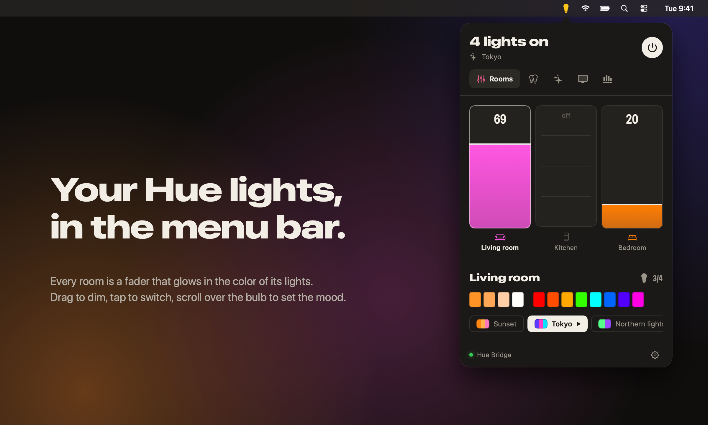
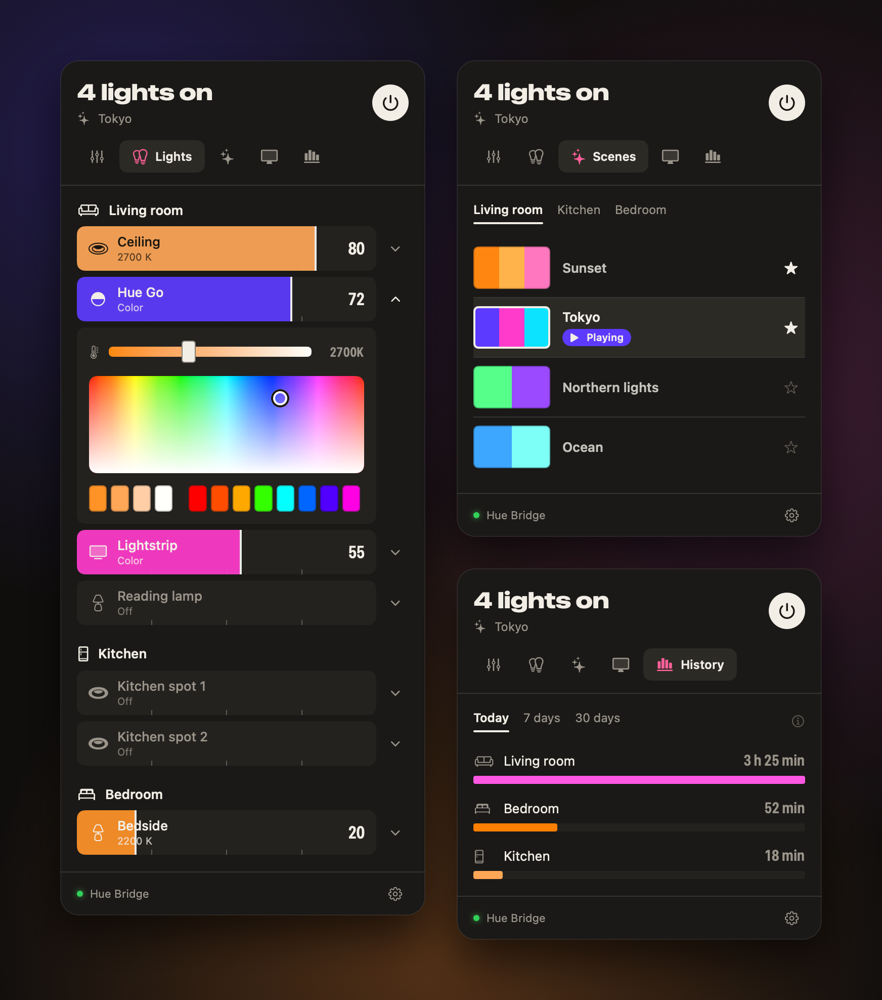

<h1 align="center">Glowdesk</h1>

Your Philips Hue lights, in the Mac menu bar.

<a href="https://github.com/tahiryildiz/Glowdesk/releases/latest"><b>Download for macOS</b></a>

## A light desk for your home

Every room is a fader, filled with the real color of its lights. Drag to dim, tap to switch, and the room follows your finger.

- **Rooms.** One fader per room and zone, plus quick whites, colors and scenes for the room you pick.
- **Lights.** Every light with the icon you gave it in the Hue app. Slide to dim, open it for white tone and color.
- **Scenes.** Your Hue scenes as swatches of color. Star the ones you love to keep them close.
- **Screen sync.** Your lights take on the colors of whatever's on your screen.
- **History.** See how long each room's lights were on today, this week or this month.
- **Menu bar.** The bulb turns yellow when any light is on. Scroll over it to dim or brighten everything at once.

Changes you make in the Hue app, with a wall switch or by voice show up instantly.

## Get started

1. Download Glowdesk, unzip it and drag it to Applications.
2. Open it. Glowdesk finds your Hue Bridge by itself: click **Pair**, then press the button on top of the bridge.

That's all. Works on macOS 14 or later with the square Hue Bridge, in English and Türkçe.

## Private by design

Glowdesk talks to your bridge over your own Wi-Fi. No account, no cloud, no tracking.

## Support

☕ If Glowdesk brightens your desk, [buy me a coffee](https://buymeacoffee.com/tahiryildiz).

Glowdesk is free and open source under the MIT License. Philips and Hue are trademarks of Signify; Glowdesk is not affiliated with them.
