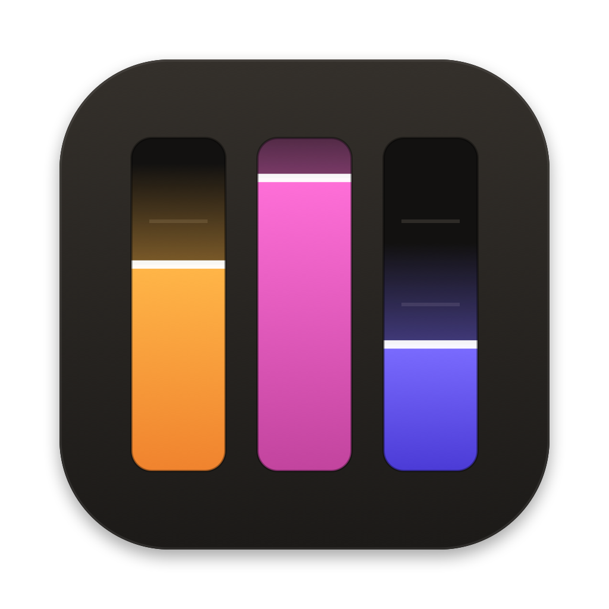

<p align="center"></p>

# Glowdesk

Your Philips Hue lights in the macOS menu bar. Each room is a fader, like a lighting desk: drag to dim, tap to switch, and the fader fills with the room's actual light color.

The design started from [LGwebOS-menubar](https://github.com/gabrielgreco1/LGwebOS-menubar). This is a community project, not affiliated with Philips or Signify.

## What it does

| Tab | |
| --- | --- |
| **Rooms** | One fader per room and zone. Drag or scroll to dim, tap to switch. Below it: quick whites, colors and scenes for the selected room |
| **Lights** | One bar per light. Drag or swipe sideways to dim; the arrow opens white tone and a color pad |
| **Scenes** | Scenes as gel swatches. Star a scene to pin it to the Rooms tab |
| **Sync** | Sends your Mac screen's main color to a room's color lights, and can restore them afterwards |
| **History** | How long each room had its lights on today, in 7 days or in 30 days |

In the menu bar:
- The bulb is yellow while any light is on and plain when everything is off.
- Scroll over the bulb to dim or brighten every lit light at once, without opening the panel.
- Left-click opens the panel. Right-click shows About and Quit.

Also:
- Lights and rooms use the icons you picked in the Hue app, matched to the closest system symbols.
- The panel sizes itself to its content, so the page never scrolls under your fingers while you're moving a fader.
- English and Turkish. The app follows your system language; change it any time in Settings.
- Faders tick on Force Touch trackpads at 25, 50 and 75 percent.
- Changes made in the Hue app, on wall switches or by voice show up live.
- Open at login is in Settings.

## Install

Download `Glowdesk-<version>.zip` from [Releases](https://github.com/tahiryildiz/Glowdesk/releases/latest), unzip it, move **Glowdesk** to Applications and open it. Releases are signed with a Developer ID and notarized by Apple.

## Requirements

- macOS 14 or later
- Xcode Command Line Tools (Swift 5.9+): `xcode-select --install`
- A Hue Bridge (the square v2 bridge) on the same network as your Mac

## Build from source

```sh
bash scripts/build.sh
open dist/Glowdesk.app
```

You can move the app to `/Applications`. It is signed locally and not notarized, so macOS may ask you to confirm the first time you open it.

## Pairing

1. On first launch the app looks for your bridge. If macOS asks for **Local Network** access, allow it.
2. When it says **Hue Bridge found**, choose **Pair**. (If it can't find one, use **Enter address manually**.)
3. Press the round button on top of the bridge within 45 seconds.

The app key and the bridge's TLS certificate fingerprint are stored in your Keychain, keyed by the bridge ID. If the certificate ever changes, the app refuses to connect; if you're sure it's the same bridge, choose **Forget bridge** and pair again.

## Screen sync

The first time you start it, macOS asks for **Screen & System Audio Recording** access; allow it and reopen the app. The screen is scaled down to 64×36 pixels a few times per second and never saved. Commands stay under the bridge's rate limit, so changes are smooth rather than frame-accurate. For frame-by-frame sync, Hue Sync and the Entertainment API are the better fit.

## Support

If Glowdesk brightens your desk, you can [buy me a coffee](https://buymeacoffee.com/tahiryildiz). The link is also in About and in the right-click menu.

## Privacy

No analytics, accounts or cloud services. All traffic goes directly to your bridge on the local network. Preferences live in macOS preferences; history lives in `~/Library/Application Support/Glowdesk/`.

## Releasing

`VERSION=1.0.0 bash scripts/release.sh` builds, signs with your Developer ID, notarizes and staples the app, and writes `dist/Glowdesk-1.0.0.zip`. The script header lists the one-time setup.

## Offline checks

No bridge needed:

```sh
bash scripts/build.sh
dist/Glowdesk.app/Contents/MacOS/Glowdesk --self-check
```

Debug builds can also render every tab with demo data: `swift run Glowdesk --snapshot <folder>`.

To troubleshoot, launch with `open dist/Glowdesk.app --args --log`. Commands, replies and live events go to `~/Library/Application Support/Glowdesk/debug.log`. The app key is never written.

## Technical notes

- Uses Hue's official local API (CLIP v2) and its live event stream.
- Slider and scroll updates are coalesced per light or group to stay under the bridge's rate limits.
- One SwiftPM target with no third-party dependencies: SwiftUI, Network, ScreenCaptureKit, CryptoKit.

## License

MIT. See [LICENSE](LICENSE). Third-party code and trademarks are listed in [THIRD_PARTY_NOTICES.md](THIRD_PARTY_NOTICES.md).
